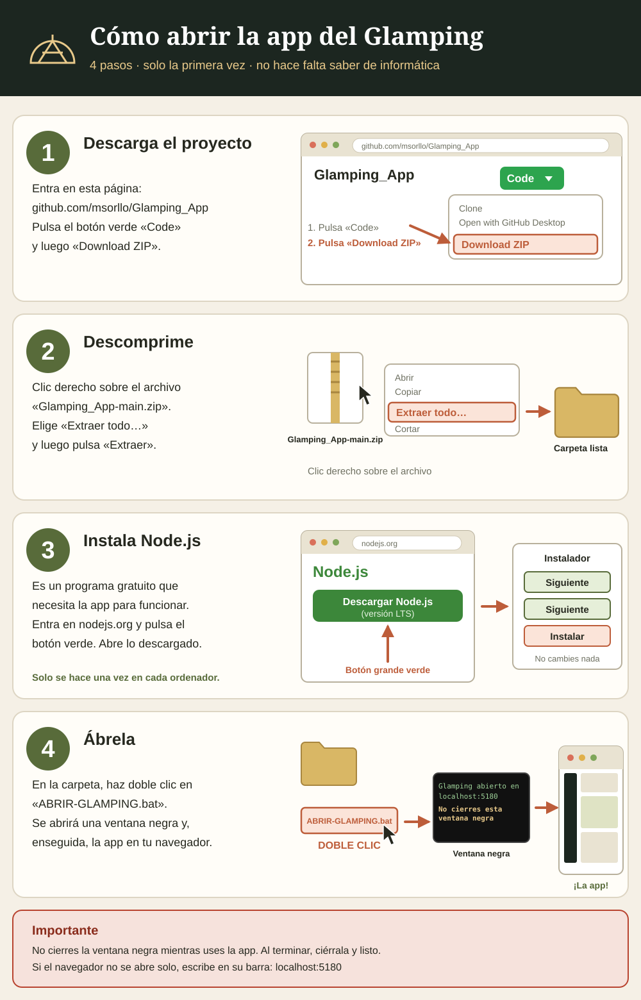

<!-- guia-visual -->
<p align="center"><a href="guia/guia-visual.svg"></a></p>
<p align="center"><b>Para abrir la app: descarga el ZIP (botón verde «Code» → «Download ZIP»), descomprímelo, instala Node.js y haz doble clic en <code>ABRIR-GLAMPING.bat</code>.</b></p>

# Glamping Maestrat · proyecto y planificador

Todo lo necesario para estudiar, diseñar y organizar un glamping cerca de Benicarló (Castellón): planos, permisos, terrenos, instalaciones, números y una app local editable para verlo en 2D y 3D.

## Empezar

> **¿Eres de los que no tocan nada técnico?** Lee **[COMO-ABRIR-LA-APP.md](COMO-ABRIR-LA-APP.md)**: 4 pasos, sin Git ni conocimientos.

1. Doble clic en **`ABRIR-GLAMPING.bat`**. Se abre la app en el navegador (necesita Node.js instalado; no hay que instalar nada más).
2. Leer **`docs/00-RESUMEN-EJECUTIVO.md`** (también desde la app, sección Documentos).

Sin el .bat: `node app/servidor.mjs` y abrir http://localhost:5180

## Qué hay en cada carpeta

| Carpeta | Contenido |
|---|---|
| `app/` | La aplicación (HTML y JavaScript sin dependencias; three.js incluido para el 3D) |
| `docs/` | 12 documentos: resumen, legal, terrenos, diseño, instalaciones, negocio, economía, operaciones, marketing, hoja de ruta, riesgos y fuentes |
| `planos/` | 16 planos en SVG: plano general por escenario, redes, incendios y cada unidad con planta y alzado |
| `datos/` | `estado.json`: lo que editáis en la app. Copiar este archivo es copiar el proyecto |
| `herramientas/` | Regenerar planos y comprobar el modelo |

## La app, sección a sección

| Sección | Para qué |
|---|---|
| Resumen | Las cifras clave y las tres fases de un vistazo |
| Terrenos y zona | Mapa y comparador de municipios con pesos editables |
| Plano general | Parcela a escala: arrastrar, girar, añadir y quitar elementos; capas de luz, agua, saneamiento, incendios y wifi; comprobaciones de normativa |
| Planos de unidades | Planta y alzado acotados de cada alojamiento y edificio |
| Vista 3D | El recinto en volumen, de día y de noche, con las redes |
| Cómo funciona | Esquemas animados y cálculo de electricidad, agua, saneamiento, restauración y recorrido del huésped |
| Economía | Inversión, ingresos, gastos, personal y financiación de los tres escenarios |
| Permisos y hoja de ruta | Lista de trámites con estado, coste y calendario |
| Organización | Equipo, turnos, tablero de tareas y protocolos |
| Clientes y marketing | Segmentos, canales y calendario comercial |
| Documentos | Lectura de `docs/` y acceso a los planos |

El selector **Mínimo / Medio / Completo** de arriba cambia todas las secciones a la vez. Los cambios se guardan solos. **Exportar** descarga una copia; **Importar** la recupera; **Restablecer** vuelve a los datos de partida.

## Compartir entre socios

Pasad la carpeta entera, o solo `datos/estado.json` (o el archivo de «Exportar») para que el otro lo importe.

## Herramientas

```
node herramientas/exportar-planos.mjs   # vuelve a generar planos/ con lo editado en la app
node herramientas/probar-modelo.mjs     # comprueba que los tres escenarios son coherentes
```

## Avisos

- Los planos son de **anteproyecto**: para tramitar hace falta proyecto firmado por arquitecto o ingeniero.
- La parte legal es una **guía**, contrastada en parte con los textos oficiales (ver `docs/FUENTES.md`), no asesoramiento jurídico.
- Los costes y precios son **estimaciones** hasta tener presupuestos reales.
